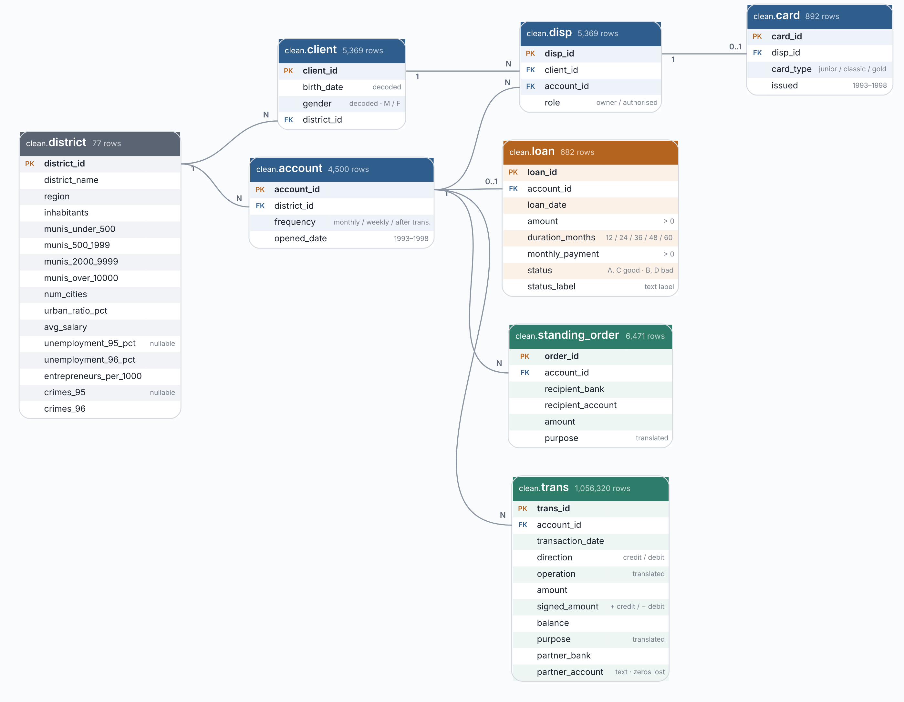

# Risk Analysis for a Czech Bank

### What characteristics indicate that a loan is less likely to be paid back?

The aim of this is to investigate whether there are characteristics that define if an individual is likely to pay their loan back or default. Several metrics will be assessed that look at financial data, social data and personal data to try and form a non-discriminatory filter to identify individuals with a larger probability of not paying back their loan.

## Data
The original data comes from The Berka Dataset which can be found here: https://www.kaggle.com/datasets/marceloventura/the-berka-dataset?select=loan.csv

# Loading
This was done through using the script 'LoadingScript.sql' and this was constructed by looking at the schema present on the website 'https://webpages.charlotte.edu/mirsad/itcs6265/group1/index.html'. The script was written all by hand and data was actually loaded after this schema was created by using the import on each newly created raw table. Data types were assigned by using the prior mentioned source as well as logic if no data type was stated in the documents.

# Cleaning
This was performed using the 'CleaningScript.sql' and quite a lot of cleaning was actually required due to the fact that a lot of the text was in Czech so translating it into English was a large part of the cleaning process. This was dealt with using a reference/translation table which is the 'ref.k_symbol' table and a lot of CASE statements in the transaction table and the standing_order table.
Implementing constraints into most rows also was necessary but predominantly 'NOT NULL' was put in-place as well as a few checks for columns that contain categorical variables such as male or female or the status column in the loan table that has to be either A, B, C or D. In the client table as well there was a significant piece of cleaning required due to the fact that the gender was encoded in the birth date of each client. Men have a birth date of the form YYMMDD and females have the form YYMM+50DD so removing the +50 from the date and recording the rows with the +50 to note that they are female was difficult and required the left-pad and right-pad functions and then extracting a specific part of the newly padded strings to get the correct month number. Labelling the gender was much easier as it all depended on the padding and substring extraction.
References was very important also to establish relationships between the tables otherwise the schema would be non-relational. This also dictated the order in which tables were created.

# Preliminary Analysis
This was done in the 'Preliminary.sql' file and essentially was used to explore the data and produce some summary statistics and assess the structure fully. There are 8 tables which are related to one another and their relationships are displayed below.

  

There are 682 loans in total with a total loaned out of CZK103261740 and there are 76 'bad' loans that total to CZK15580152, whereby a bad loan is deemed as one with a status of B or D. B means the loan was not paid back and D means the loan is on-track to not be paid which gives an overall default rate of 11.1%. In the data there are 4500 accounts linked to Berka bank but only 682 of them have taken out loans.
Looking at a yearly view we see that there are 6 years where loans were issued (1993-1998) but the first loan was issued in July 1993 so only half of this year is present and the last loan was issued in early December of 1998 so these 2 years' totals are not as representative as the others. The table below shows all of the summary statistics for the yearly view.
| Loan year | Loans | Bad loans | Default rate | Finished loans | Finished unpaid | Finished default rate | Still running | Running, in arrears | Amount lent (CZK) | Lent on bad loans (CZK) |
|---|---:|---:|---:|---:|---:|---:|---:|---:|---:|---:|
| 1993 | 20 | 4 | 20.0% | 20 | 4 | 20.0% | 0 | 0 | 2,619,276 | 811,284 |
| 1994 | 101 | 14 | 13.9% | 85 | 12 | 14.1% | 16 | 2 | 13,379,904 | 2,898,972 |
| 1995 | 90 | 12 | 13.3% | 51 | 6 | 11.8% | 39 | 6 | 13,344,372 | 1,880,184 |
| 1996 | 117 | 16 | 13.7% | 35 | 6 | 17.1% | 82 | 10 | 18,317,676 | 2,628,600 |
| 1997 | 196 | 26 | 13.3% | 43 | 3 | 7.0% | 153 | 23 | 30,731,364 | 6,263,292 |
| 1998 | 158 | 4 | 2.5% | 0 | 0 | – | 158 | 4 | 24,869,148 | 1,097,820 |
| **Total** | **682** | **76** | **11.1%** | **234** | **31** | **13.2%** | **448** | **45** | **103,261,740** | **15,580,152** |

Have to be careful with the different categories of loans, eg unpaid and finished, on track to be paid, etc. as they all represent different types of loans. In the 'proper' analysis we will mainly be looking at bad loans as defined above due to the fact that from the perspective of a bank, a loan that has finished in arrears is as bad as a loan that was unpaid.
A note with regards to 1998, 154 of the 158 loans are rated as C which means they are 'OK so far' and as statuses of A and B are the only ones with a final result these C-rated loans in reality would be difficult to rate as they are primarily new loans. What could be done is picking a point in time and assessing the loans using the individual's stats and their loan duration but this is highly inaccurate and makes a lot of assumptions that do not need to be made. This would produce results but mostly meaningless as they hinge on baseless assumptions.

# Views
The purpose of this is to create the necessary tables in order to create the correct visuals in Power BI. The reason views are used is due to the fact that the raw tables are not ideal for visualising and telling the appropriate story about the data. A view allows us to see a different side of the raw data ad the views have been catered to visualise the most important data/metrics.

# Analysis

This will look at several different metrics individually as well as combined metrics to try to determine what allows for the best filtering of customers without overfitting and try to create a filtering rule the bank can use. The dataset has been split into test and training data whereby the training data covers loans from the years 1993 - 1996 then the test dataset covers loans from 1997 - 1998. There are 328 loans in the training dataset and 354 in the test dataset so ~5% difference. The reason for this is to actually verify the efficacy of the rule being implemented; just looking at the rule across the dataset as a whole provides the bank with no predictive value or any indication that in reality that this may work. Judging performance of the rule on the test data is how the bank may decide to implement the rule or not as it shows what the rule possibly could have saved/benefited them.

## Correlation Matrix
The correlation matrix was created using the loan_features view to see how different features correlated with one another which allowed me to see where to direct the analysis at. The correlation of variables with is_bad will be of interest due to the fact that this column is representative of bad loans and the wole purpose of the analysis is to try and sift out bad loans before the bank lends the money.
Looking at the matrix, account age and number of transactions are highly correlated as these are similar metrics: an older account is more
likely to have more transactions than a younger account simply due to probability. The usage of account
age is better than the number of transactions as it is easier to make an enforceable rule simply because transaction count can easily be manipulated to achieve a larger number of transactions in a short period. Looking at an individual's age my reveal insights to age categories possibly having higher/lower default rates than others but this would be impossible to enforce in the scenario where (for example) 30-40 year olds default significantly more than any other age group. So if someone had an account and turned 30 despite having the account for 6 years they would suddenly not be able to take a loan it it seems largely illogical to implement this. Obviously, this is a single metric and would be used alongside others but age for me does not seem like a deciding factor initially anyways but it will be looked at out of curiosity.
The loan_features view also contains several metrics in relation to the account holder's financial status and contains features including minimum balance, maximum balance, average balance, monthly payments and so on. These all point to the same thing (the account balance) but in slightly different ways so looking at all of them is unnecessary. I decided to look at 3 financial metrics which are the affordability ratio, the number of months overdrawn and the minimum balance of an account and these will be explained below.
Several metrics will not be used at all due to either the lack of data or lack of relevance to deciding default rates, for example, there are unemployment figures for every district but only in 1995 and 1996 so creating a rule based on this column is unwise. Other columns like ID columns, unemployment, loan date, card before a loan and membership type were not used due to me deeming them irrelevant towards making a rule. Also, due to the fact that the train-test split splits the data into 2 smaller portions and train has only 46 bad loans which is quite small, meaning that every feature investigated could find another pattern that is actually noise by chance produces a significant finding rather than because there is actual significance there. If I looked at every single feature using several different cutoffs there will inevitably be significant findings, hence hand-picking a few features. The most important part of a rule here is that it is usable prior to the loan and the data used to create the rule is not only available post-loan; it has to be available pre-loan. 
The features chosen were based on business rationale rather than randomly deciding and cutoff values were chosen through observing the data at these values.

## Affordability
The affordability ratio is defined as an account's monthly payments divided by their average monthly income over the 6 months leading up to them taking out the loan. The average monthly income over the 6 months prior to taking the loan out was done by summing up all of the credit transactions for each account for the 6 months leading up to the loan being taken out. The issue with this is that the owner of the account may receive income through another bank account that could not have been recorded in this data or they may have received cash payments that did not go through this bank so I have assumed their monthly income is purely based on money coming coming into their account with this bank, which I think is quite a safe assumption but also one that cannot be verified/tested as to how good it is.
An affordability ratio of 1 or more indicates that the account's monthly payments are larger than their average monthly income and essentially says that according to their average monthly income they cannot afford to pay the loan back on-time. This uses an average which may be interpreted as slightly inaccurate but as loan durations are at least 12 months this is safe to use and representative. This is also where the prior assumption could affect what is happening in reality as they may have another source of income that this bank is not picking up which may help them pay for the loan and this becomes especially relevant for the loans that are still ongoing when this dataset finishes.
Looking at the affordability section of the analysis script, I first banded affordability into 4 different bands and split by train and test but an issue arose straight away which was that there was 2 bad loans in the test split and 8 in the train split. Affordability is only analysed for accounts with less than six months history before the loan due to the fact that these accounts do not have enough history to judge them accurately on behaviours such as balances or overdrafts. Affordability only requires the loan terms and their income. More mature accounts are screened on balance behaviour instead and this already captures most of what affordability would add. This is why there are only 10 bad loans present and split in the way they are and the reason this is an issue is that the sample size of 2 loans is too little to draw any meaningful conclusions. It is very difficult to reliably determine what we are seeing is noise or an actual signal.
Different affordability values were still assessed to see if there was any signal that may have some significance and from viewing the training data I found that at an affordability of more than 0.3 there may be a predictive signal but when this comes to rule making if a row has this value it will be flagged for review rather than an automatic decline/approve.
From assessing the different cutoffs for the affordability ratio the best value to maximise bad values declined and minimise good loans declined is difficult to figure out as each cutoff in the train dataset does not catch many bad loans at all and at most it flags 38 loans out of 682 loans. This is further evidence that as a solo metric it is very difficult to use meaningfully.

A note in the bad_value_avoided column: this is slightly misrepresented as a 'bad' loan is typically partially paid back so not all of the loan amount is bad, just the portion + the interest that does not get paid back which is formally calculated when the rule is made.

## User age
This was looked at simply because like most risk-associated products like insurance, age is a determining factor in the premiums and risk associated with the product so I thought to investigate it. Looking at the age query we can see that default rates are insignificantly different between each age group for the test set and the train set so I deemed this to not be of any value.

## Account age
Looking at the account age bands we see that as the age of an account increases on average the default rate (loas rated status B or D) decreases. This is somewhat expected as if younger accounts start defaulting on loans their loan and then account could be terminated with the bank so this could be due to survivorship bias, but the data is unable to tell us this due to the fact that account determination is not recorded. As an isolated feature there is no real predictive power in the training set and the test set also.
Note for the cutoff values, I started it at 150 rather than 0 due to the fact that all loans were given to accounts that were at least 3 months old so this is evidence that the bank may already have their own rule in-place about minimum term length with the bank to take a loan out.

## Minimum Balance
This is where a large portion of the analysis was performed and the reason for this focus is that it reveals an insight into the borrower's floor/cushion before their next paycheck. An average balance can be inflated by temporary lumpsums, ie straight after payday before any payments for the month have left their account, and therefore are less representative of the account's ability to pay back the loan and a maximum balance again can be inflated by temporary payments or pre-bills being paid. The minimum balance represents the extra money leftover after all expenses and bills have been paid. If this is large it shows that the account has the potential to pay back their loan comfortably. If an account dips to very close to 0 often also then they have no margin for error for an unexpected expense which when that may happen can easily lead to missing loan repayments.
For the entire minimum analysis I had a filtering clause that looked at only loans where there months_history = 6 which due to the way I defined months_history means accounts with 6 or more months of transaction history prior to the loan being taken out. This is included due to the fact that many newer accounts have a lower minimum balance simply because they are newer which is noise rather than indicative of a signal. This excludes 82 loans in total with 81 of them being in the lowest minimum balance band and 1 being in the second lowest salary band. I decided to split the data into 4 bands initially based on the minimum balance to look at the band minima and maxima as well as the number of bad loans and default rate in each. The lowest band (after applying the months_history = 6 filter) has 72.6% of all bad loans and has a default rate of 50.56%. Compared to the higher 3 bands the highest default rate is 4.73% only, showing that the minimum balance is very likely to be a determinant in the likelihood of an individual paying back their loan in full.
As this has produced a clear potential sign that minimum balance could help in making a rule, I used the test-train split and assessed different cutoff values in the training set, looked at what cutoff was 'practical' in regards to rejecting a good amount of bad loans and rejecting a sall number of good loans as well as the bad value avoided and the good value declined and found that 
he filter of months_history = 6 is largely significant here. This filters to only loans from accounts that 
have at least 6 months of history/transactions with the bank prior to taking out a loan. Just looking
at each minimum balance band and all loans within those bands the default rate for the lowest band is just over 32%.
Looking at the lowest band with the 6 months filter we see that the default rate goes up to 50.56%. The reason
this is needed is that many newer accounts have a lower minimum balance simply due to account age. If 
we remove the months_history filter the lowest minimum balance band has an average age of 309 days and
the upper 3 tiers have ages of ~427 days. Adding in the 6 month filter the average account age for the 
lowest band goes up to 462 days, showing that this filter eliminates a lot of the younger accounts and this
could show that these accounts are in the lower band simply because they are newer.

Trade-off at each threshold value. Rule: decline if the minimum balance < cutoff value

### LGD Value
For status B here the unrepaid share is 0.232 and using the ratio calculated above (1.166) 
this gives a break-even interest rate of 0.232 x 1.166 ~27%
A note on C and D: the unrepaid share is high simply because these loans have not yet finished yet

-- The rule avoids CZK 5569596 of bad-loan principal and decines 4775232 of good-loan principal, creating 
-- a ratio of ~1.17. But, a decline good loan only costs the bank in interest it would have earned and an approved 
-- bad loan costs only the unrepaid share of its principal, the loss given default or LGD.
-- The dataset does not record the interest paid so a break-even view is used instead but the rule to keep in mind is
-- LGD x 1.17 > lifetime interest earned as a percentage of the principal.
-- Assuming bad loans lose ~50% of principal still means that the rule pays as long as good loans do not earn
-- more than ~58% of principal interest over their life, which is far above the typical consumer-loan returns.
-- The ratios can be viewed by running line 126.

Want to look at the test rows here. For finished loans, 41 were finished
with 2/3 flagged correctly as bad and 16/38 flagged incorrectly as bad that 
were actually good, but this is quite a small sample size at only 41 loans and only 3 bad
loans in total so it is insufficient evidence.
For the running test loans 80% of bad loans were correctly
flagged as bad and only 10.1% of good loans were incorrectly fagged as bad, showing
the cutoff to be quite good at surfacing potential bad loans.

This test at the chosen cutoff shows 54 loans to be rejected where 22 of them were bad and 32 of them were good.
Test period has 296 good, 'mature' loans therefore 32/296 = 10.8% of good loans wrongly flagged.
40.7% of loans flagged are bad loans and 2.2% of unflagged loans were bad. False positive (falsely flagging a good loan)
rate is 10.8% and false negative (flagging a bad loan as good) rate is 2.2%. CI at 95% is 25.3 - 51.7 pp and 
z=9.2 corresponds to p~10^-20 and represents the probability of seeing a gap of 38.5 percentage points between if there is 
no real difference and is strong evidence to suggest that this gap is not due to random noise.

The confidence interval represents the interval which the size of the gap would fall into 95% of the time. 
The width is quite wide either side at 13.2 percentage points but this is mostly due to smaller groups. The
effect is definitely present but the size is uncertain. NOTE: the unflagged group only has 6 bad loans which is fine
but it just clears the requirement of 5 for the normal approximation. this analysis shows the effect is real
but does not quantify the effect of it

## Months Overdrawn
-- Can see that this is a huge discriminant in finding out if a loan will be good or bad.
-- Every single loan given out to an account that had at least 1 month of being in overdraft was a bad loan
-- but this is unclear if that is due to small sample size as only 20 accounts had months of overdraft
-- before the loan was take out compared to 662 that did not, but the fact that 100% of loans with at least 1
-- month overdrawn lead to 'B' or 'D' ratings is significant. It catches 26.3% of all bad loans

-- Very clear to see that even with the train/test split we see that 
-- if an account had any months where they were overdrawn prior to taking their
-- loan out the loan is bad 100% of the time with 9 bad loans in the train split
-- and 11 of them in the test split.
-- There is quite a small sample size with the overdrawn bad loans so taking the
-- numbers at face-value is unwise here. Producing confidence intervals would tell us
-- whether the results were due to a small-sample accident or whether they are 'genuine'.
-- The confidence intervals reveal that the results are not due to a small-sample accident
-- as the lower bound in the test-overdrawn category is almost 9 times larger than
-- the highest plausible rate for everyone else.
-- Looking at the duration of loans is more of a summary page rather than
-- anywhere to investigate further. Largest issue with this feature is that 
-- a large proportion of the loans are still running at the end of this dataset and 
-- as there is no consistent pattern or signal.

## Districts
-- Assessing districts as a whole we can see that per-district there are 
-- not many loans and therefore deriving any conclusions based on the district alone
-- is unwise and will lead to noisy and possibly incorrect interpretations.

## The Rule
- This shows how the rules would have performed if they were applied on the years
-- 1997 and 1998, developed from training on the 93-96 data.
-- Looking at the test data we see that are larger percentage of all loans are declined,
-- going from 11.6% in the train set to 15.3%, with the percentage of bad loans 
-- being declined rising by 21.1 percentage points and the percentage of good loans being
-- declined rising by 4.9 percentage points.
-- The metrics do look good percentage wise but need to assess the 'raw' numbers and assess
-- actual currency amounts.
-- Firstly, the good value declined metric and the bad value approved metric do not 
-- represent missed business or losses. They represent the values of loans that would have been
-- approved or declined incorrectly. Declining good value means the bank misses out on their
-- interest payments that the bank actually would have received and approved bad value 
-- is concerned with the portion of the loan that is not paid back as well as the interest 
-- missed out on.
-- The LGD calculated earlier at 0.232 means that bad loans repay 76.8% of the
-- loan amount, therefore declining a bad loans saves the principal - 0.768 x loan_amount,
-- declining a good loan costs loan_amount - principal (interest they would have earned) and 
-- therefore the net benefit is the sum of savings on bad decline loans - the sum of cost of decline good loans.

-- there is no principal stated in the data so I have assumed an annual rate to find the principal amount
-- using the monthly payment. This was calculated using the standard loan annuity formula:
-- monthly_payment * (1 - POWER(1+rate/12, -duration_months))/(rate/12) where the rate is 
-- tested at different values.

-- "The data contains no interest rates. Principal was backed out of the monthly payment under an assumed rate,
-- and bad-loan losses were valued using an empirical LGD of 23.2% from finished defaulted loans.
-- At these assumptions, the rule beats approving everyone when the bank's net margin on lending is below about 6–7% a year.
-- Above that margin, the interest given up on wrongly declined good loans outweighs the losses avoided. If the bank's margin is higher,
-- the rule should send applicants to manual review rather than declining them outright."

-- Caveats
-- The 0.232 is likely too low for this group. It was measured on finished bad loans (status B), but most of the test bad loans you decline are D, still running. Some have already made payments, and some recovery may still come, so their eventual loss is unknown. Using 0.232 for them is an assumption. If their LGD is higher, the break-even rate rises.
-- The relevant rate is the bank's margin, not the rate charged to the customer. If the bank doesn't lend money out, it also doesn't pay to fund it. So the interest given up on a declined good loan is really the margin above the funding cost, which makes the rule look better than the table does.
-- No time value, collateral or collection costs are included. Name these as limitations rather than modelling them.
